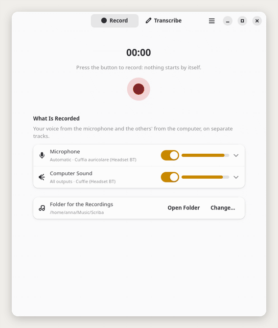
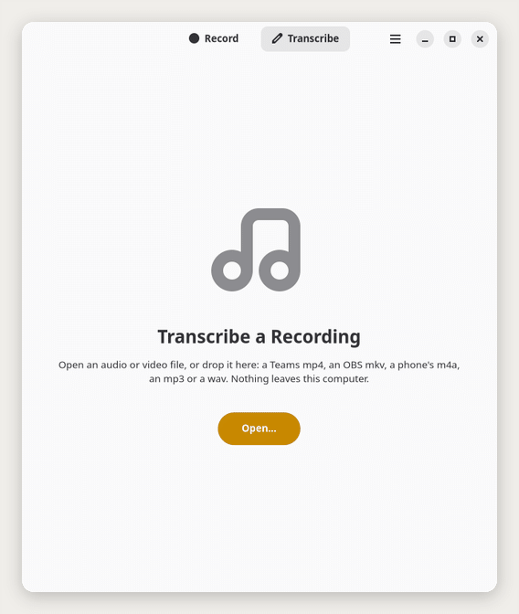
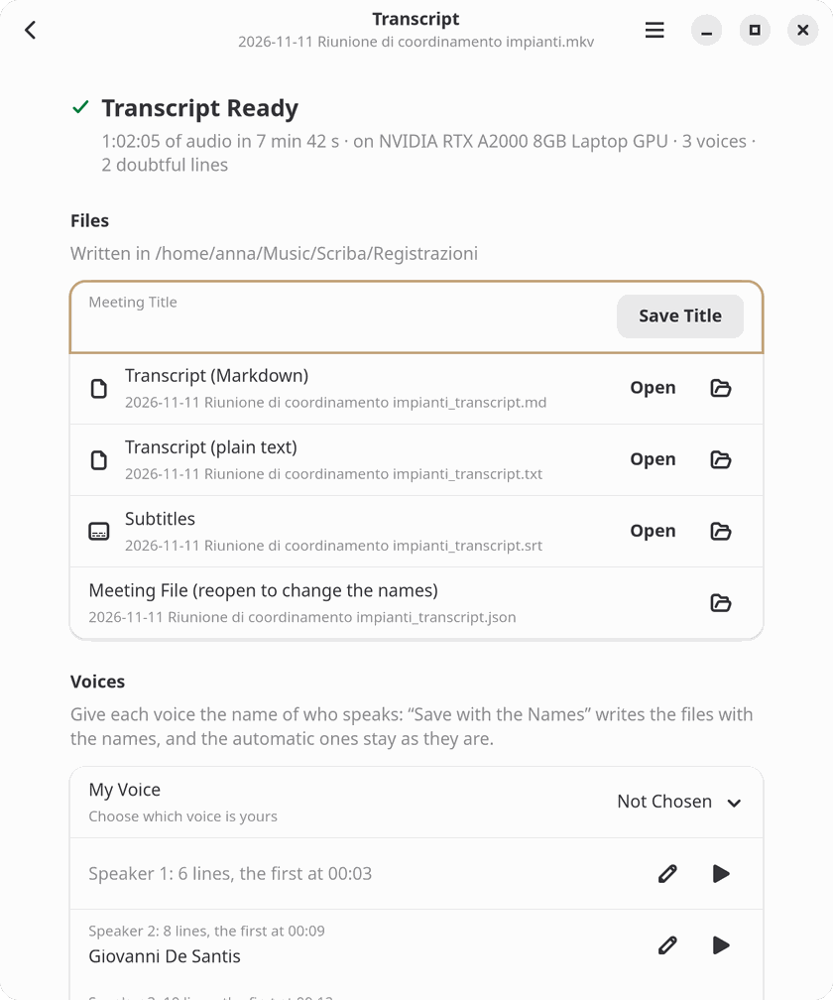
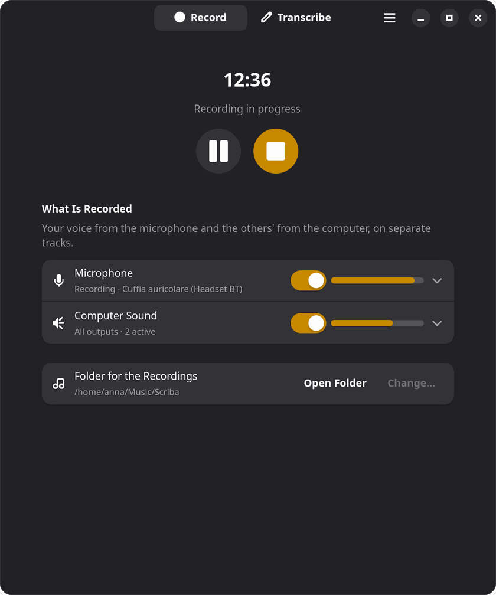

<p align="center">
  
</p>

<h1 align="center">Scriba</h1>

<p align="center">
  Record meetings and transcribe them on your own computer, with speakers and subtitles.<br>
  <a href="https://github.com/daniel-g-carrasco/scriba/releases/latest"><b>Download for Windows</b></a> · <a href="#linux">Flatpak for Linux</a>
</p>

Scriba records the microphone and the computer's sound on separate tracks, or opens a recording you already have, and turns it into a transcript with who said what: Markdown, plain text, subtitles, and a copy of the video with the subtitles inside. Audio and text never leave your computer; the network is used only to download the speech models and to check for updates.

The window has two tabs, **Record** and **Transcribe**, and that is most of it.

## Record

<p align="center">
  
</p>

- **Two tracks, kept apart**: your voice from the microphone, the others from the computer's sound. Each has its own level meter, so you see that both are coming in before the meeting starts. Nothing starts by itself: recording begins when you press the button.
- **The right devices**, chosen from the system's own information on call devices and sound levels. On Windows, with automatic selection, Scriba switches to the microphone a call program opens after recording has started; on Windows 11 it also follows the call's mute (speech while muted is recorded but not transcribed as yours; this can be switched off in Preferences). Check the microphone and output and their meters before recording: a real call with a Bluetooth headset still needs validation, and automatic selection is not a guarantee that every call setup is captured.
- **Names from Teams.** On Windows, during a Microsoft Teams meeting, Scriba can read who is speaking from the coloured border Teams draws around the speaker's tile, also when the Teams window is behind others (not when it is minimized). Only names and times are kept, never images. The recording page says when Teams cannot be read; **Names from Teams** in Preferences switches it off.
- **No echo of the loudspeakers.** When the microphone picks up the computer's loudspeakers, Scriba removes that echo from the microphone's track before transcribing and in the copy to listen to; the original recording is kept unchanged. Headphones still give the best transcript.
- **Every recording has a folder of its own.** Recording uses progressive FLAC tracks; once the joined recording is checked, those intermediate files are removed and their original tracks remain in the MKA.

## Transcribe

<p align="center">
  
</p>

- **Any recording**: a Teams mp4, an OBS mkv, a phone's m4a, an mp3 or a wav, opened or dropped on the window, or the one just recorded. You choose the language, the quality, how many people speak, and the words that must be written right (names, acronyms, the client, the project's code); files of terms chosen in Preferences, one term a line, are read at every transcription too.
- **Who said what.** The voices are told apart and the transcript is written in paragraphs per speaker. Your microphone's voice takes the **My Name** preference (initially **Io**); the others can be named on the Result page, with a short excerpt of each voice to listen to. After a Teams meeting the names read from Teams are proposed, with the share of speech that matched; they stay editable, and enter the files with **Save with the Names**. A meeting JSON can be reopened to correct names without transcribing again.
- **The files**: Markdown, plain text, subtitles (at most two lines of 42 characters and 7 seconds), and a copy of the video with the subtitles inside. A new transcription of the same audio keeps the previous transcripts in a folder of previous revisions.
- **Honest about doubts.** Doubtful lines stay in the text, marked `(?)`; when more than a quarter of the text is doubtful, the files and the Result page say so and advise listening again.
- **A copy to listen to**, with the balance between the microphone and the other participants when their original tracks are there, and a short preview before saving.
- **On your graphics card when it helps.** The app benchmarks the graphics cards and processor on a bundled public-domain speech sample, checking the words as well as the speed, and says how long the work should take. Actual processing time depends on the computer and the recording.

## Gallery

| | | |
|:---:|:---:|:---:|
|  |  |  |
| Recording, two tracks | A recording opened | The work going |
|  |  |  |
| The result, voices to name | The whole transcript | The models, at the first start |
|  |  |  |
| Open or drop a recording | Light and dark… | …styles |

The pictures are the real window with made-up meetings and names (`tools/readme_pictures.py`).

## Install

### Windows

**[Download Scriba for Windows](https://github.com/daniel-g-carrasco/scriba/releases/latest)** and choose the `scriba-setup-…-windows-x64.exe` installer. Scriba checks for newer stable releases and verifies their installer signatures before updating. Windows may show a SmartScreen warning because the installer has no Authenticode certificate: choose **More info**, then **Run anyway**. Chrome may keep the download as "Unconfirmed … .crdownload" because the file is rarely downloaded: open the downloads list (`Ctrl+J`) and choose **Keep** before opening it.

The release also has a portable ZIP: extract all of it before opening `Scriba.exe`.

### Linux

From the app's own signed Flatpak repository (GNOME Platform 50, transcription on the processor or with Vulkan):

```bash
flatpak install https://daniel-g-carrasco.github.io/scriba/scriba.flatpakref
```

The repository key's fingerprint is `2A17 1ED4 30D6 082E DED4  73B5 DFA3 8180 5867 7201`. Every release also has the Flatpak bundle and the corresponding sources. Linux dependencies, permissions and local builds are in [docs/linux.md](docs/linux.md).

### The first start

The first start downloads the checked speech models: about 600 MB for the fast transcription model, the speech filter and the voice embedder. The Models page shows the progress and any error. Recording works while they download; transcribing needs them. A larger, slower model is optional and is downloaded only when asked for on the same page.

By default, closing the window keeps Scriba running in the notification area when the desktop has one. Its icon shows recording, pause, transcription, download and error states. Reopen the window from the icon, or choose Quit to finish saving and exit. This can be switched off in Preferences. On Linux desktops without a supported notification area, closing the window quits as usual.

## Command line

```bash
python bin/scriba transcribe recording.mkv --speakers
python bin/scriba record 60 --out RECORDINGS_FOLDER
python bin/scriba check
```

FFmpeg and whisper.cpp are driven as child processes. A local LGPL build made with `tools/build_ffmpeg.sh` is preferred to FFmpeg on the PATH. User models are stored outside the installed program, or in the folder given by `SCRIBA_MODELS_DIR`.

## Development

Development uses Python 3.14 in MSYS2 UCRT64, GTK 4 and libadwaita. The package list and build steps are in [.github/workflows/windows.yml](.github/workflows/windows.yml). From a UCRT64 shell with the dependencies installed:

```bash
python tools/compile_po.py
env -u MSYSTEM python bin/scriba
```

On Windows, launch MSYS2 from PowerShell so its environment is preserved:

```powershell
$env:MSYSTEM='UCRT64'
& C:\msys64\usr\bin\bash.exe -lc 'cd /c/path/to/scriba && ruff check --select F,E9,B . && env -u MSYSTEM python -W default -W ignore::DeprecationWarning:gi.events tools/run_tests.py tests'
```

Window tests require a display. Optional engine and recording tests need their explicit test variables. Screenshots use invented data:

```bash
python tools/screenshots.py --out screenshots       # every state of the window, to look at before a page is done
tools/readme_pictures.sh OUT record                 # the README's pictures, in a throwaway home on Broadway (Linux)
python tools/readme_gif.py OUT record data/screenshots/usage-record.gif 1.6 0.4 0.4 0.4 0.4 0.4 0.4 1.6
python tools/make_icons.py
python tools/make_ico.py
```

Windows and Linux CI check pushes and pull requests and build development artifacts. Pull requests do not run signing or publishing jobs. A separately authorised version tag runs release signing and the signed Flatpak repository workflow. The complete-release check requires every platform's files and signatures before publishing a draft.

## Licence

Scriba is licensed under GPL-3.0-or-later; see [COPYRIGHT](COPYRIGHT), [LICENSE](LICENSE) and [distribution notes](docs/licensing.md). Third-party engines, models and libraries retain their own licences and credits. Release signatures and verification are described in [CODE_SIGNING.md](CODE_SIGNING.md).
