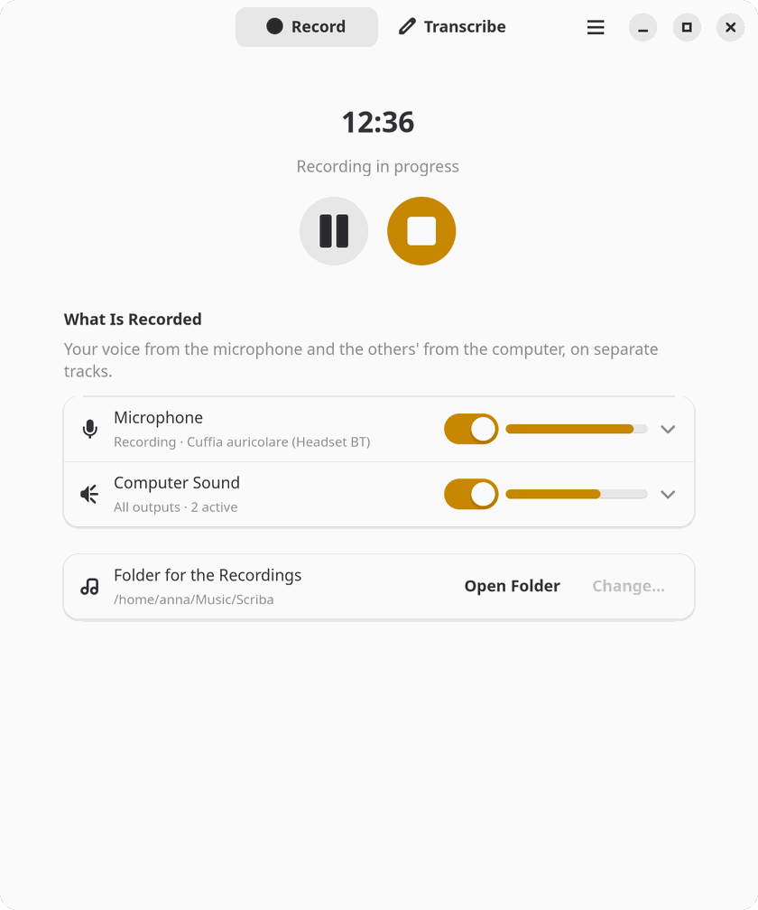
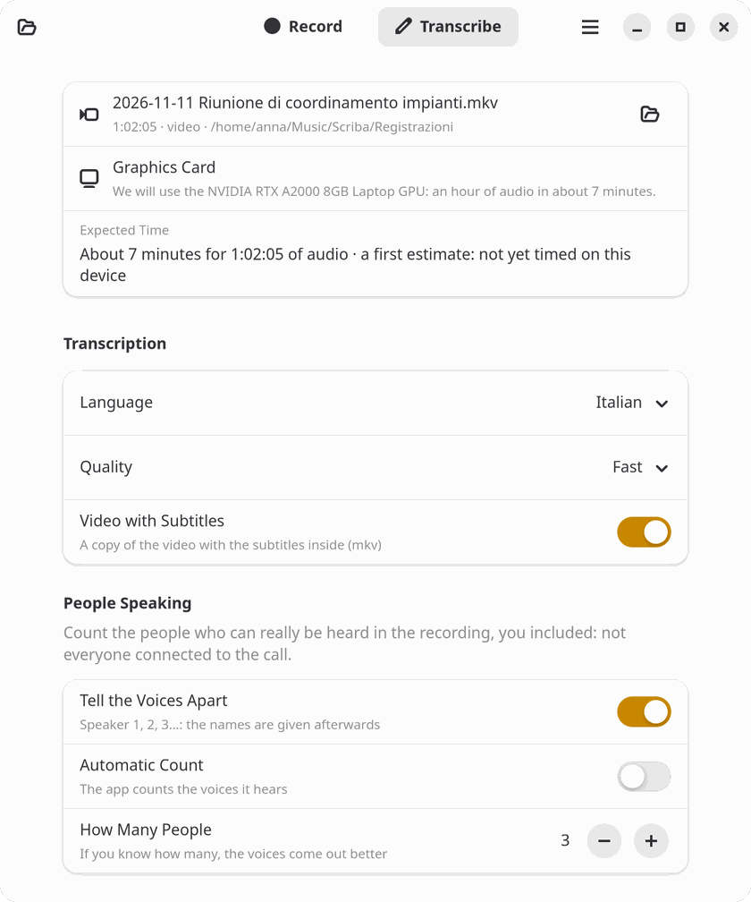
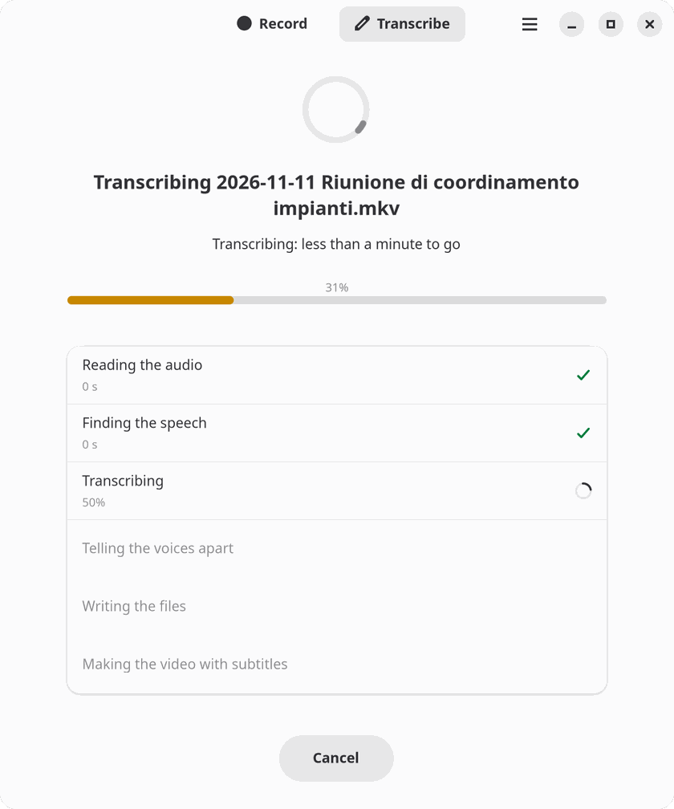
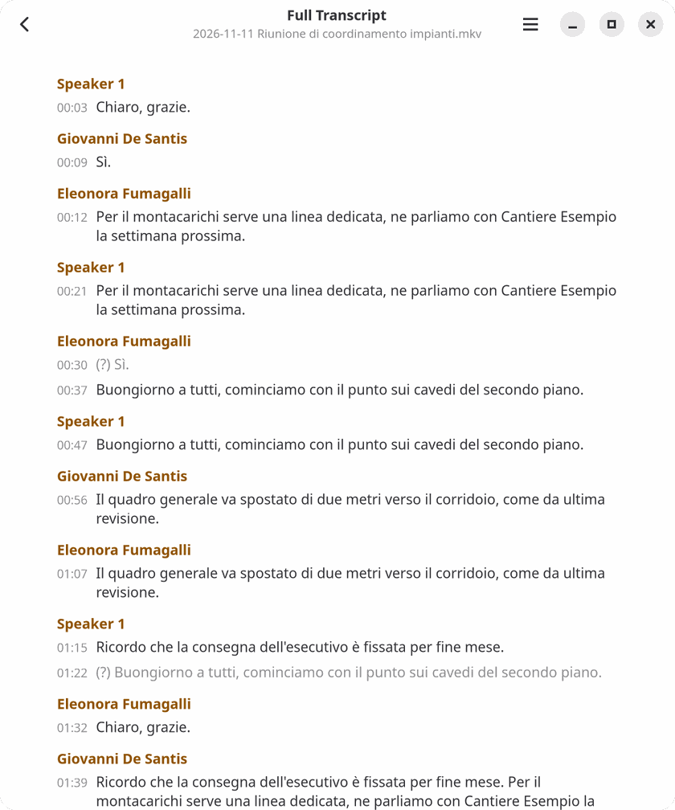
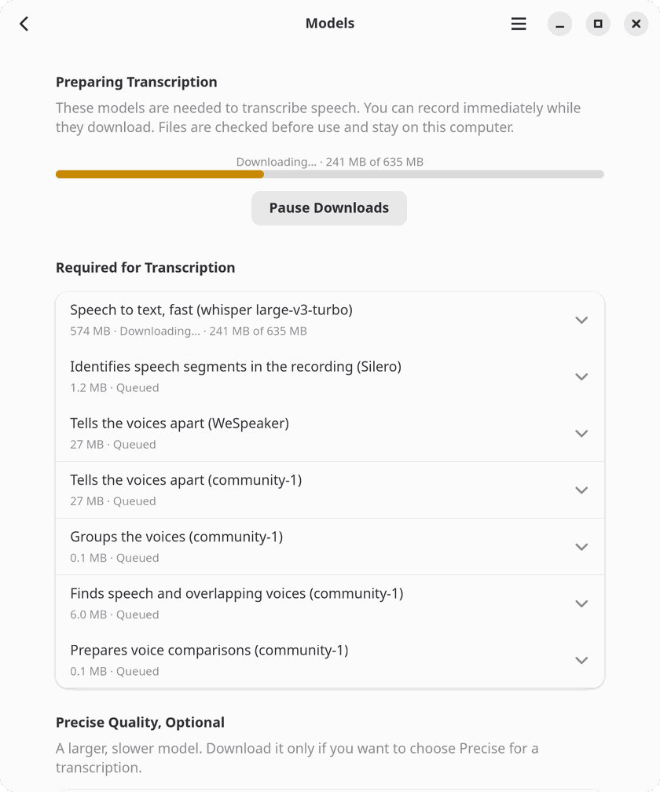
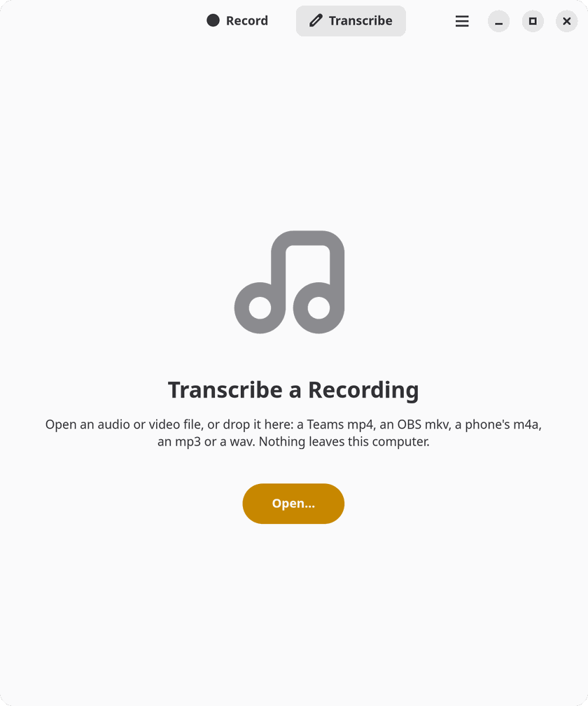
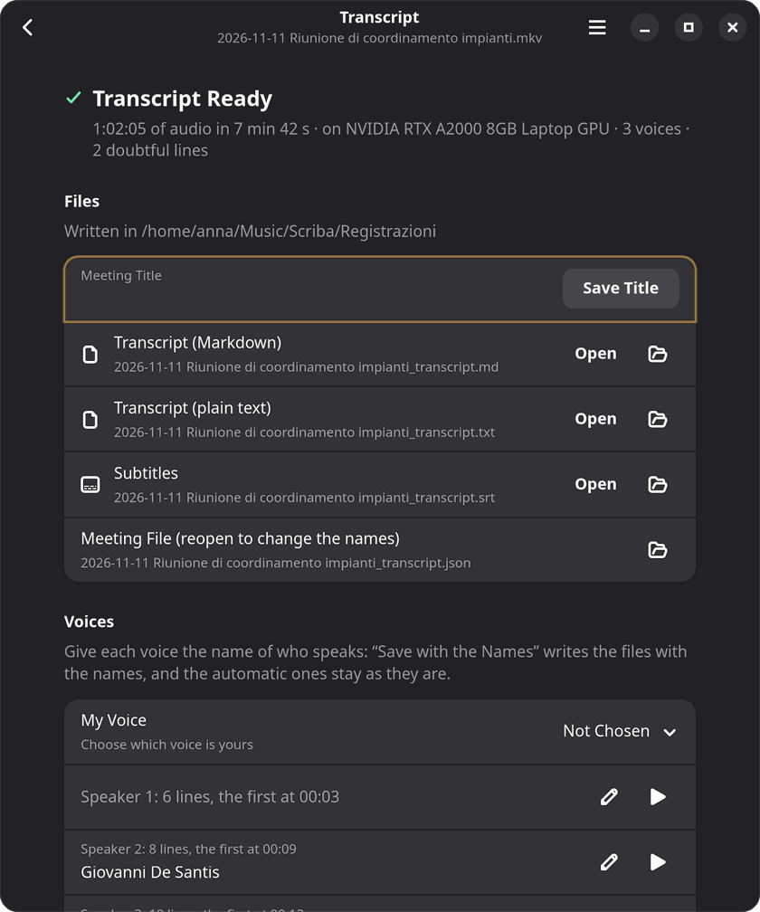

<p align="center">
  
</p>

<h1 align="center">Scriba</h1>

<p align="center">
  Record meetings and transcribe them on your own computer, with speakers and subtitles.<br>
  <a href="https://github.com/daniel-g-carrasco/scriba/releases/latest"><b>Download for Windows</b></a> · <a href="#linux">Flatpak for Linux</a>
</p>

Scriba records the microphone and the computer's sound on separate tracks, or opens a recording you already have, and turns it into a transcript with who said what: Markdown, plain text, subtitles, and a copy of the video with the subtitles inside. Audio and text never leave your computer; the network is used only to download the speech models and to check for updates.

The window has two tabs, **Record** and **Transcribe**, and that is most of it.

## Record

<p align="center">
  
</p>

- **Two tracks, kept apart**: your voice from the microphone, the others from the computer's sound. Each has its own level meter, so you see that both are coming in before the meeting starts. Nothing starts by itself: recording begins when you press the button.
- **The right devices**, chosen from the system's own information on call devices and sound levels. On Windows, with automatic selection, Scriba switches to the microphone a call program opens after recording has started; on Windows 11 it also follows the call's mute (muted intervals are silent in the listening copy and transcript, and the original microphone track retains the sound. Change this in Preferences). When a detected call ends, Scriba can stop after five minutes of silence unless you choose **Continue**. Adjust the timeout in Preferences. Check the microphone and output and their meters before recording: a real call with a Bluetooth headset still needs validation, and automatic selection is not a guarantee that every call setup is captured.
- **Names from Teams.** On Windows, Scriba can read the coloured border around a Teams speaker's tile, including one-pixel borders on high-resolution screens. The largest number of people seen, including your own tile, is suggested in Transcribe. The recording page reports when names are unavailable or when no speaker has been recognised for five minutes. Its state file keeps minute-by-minute counts and the peak coverage of each border side. Scriba keeps names and times for speaker suggestions and discards captured images. **Names from Teams** in Preferences switches off reading tiles.
- **No echo of the loudspeakers.** Scriba removes echo from the microphone before transcribing and in the listening copy. The original keeps its sound. Open an old recording in Transcribe to make a new listening copy that honours call mute.
- **Progress after stopping.** The Record tab, notification area and quit dialog show the estimated finish time while Scriba saves the recording. You can skip finishing and create the listening copy later from the Transcribe tab.
- **End of the call.** On Windows, Scriba sends a notification with **Stop** and **Continue**, including while Scriba is in the tray. The visible window also shows the time left before the automatic stop.
- **Choose a cut.** At stop the timeline proposes the call interval when available. Drag either handle, use the arrow keys (Shift for ten seconds), or type the two times. Choose **Trim** or **Keep All**. After two minutes Scriba applies the selection shown on the bar.
- **See or edit a cut.** Transcribe shows the saved part of the whole recording. **Edit Trim** lets you choose again from the complete recording in Previous revisions. Trimming keeps the tracks without re-encoding and refreshes the listening copy. Transcribe the new selection when you need its text.
- **Every recording has a folder of its own.** It starts with the date and time. Scriba adds the meeting title at stop if it knows it. The folder also follows changes to the title on the Result page. Recording uses progressive FLAC tracks. Once the joined recording is checked, the intermediate files are removed and their original tracks remain in the MKA. When a recording or save was interrupted, Scriba offers to finish it when it opens again.

## Transcribe

<p align="center">
  
</p>

- **Any recording**: a Teams mp4, an OBS mkv, a phone's m4a, an mp3 or a wav, opened or dropped on the window, or the one just recorded. You choose the language, the quality, how many people speak, and the words that must be written right (names, acronyms, the client, the project's code); files of terms chosen in Preferences, one term a line, are read at every transcription too.
- **Who said what.** Scriba writes the transcript in paragraphs per speaker. Your microphone's voice takes the **My Name** preference (initially **Io**). The Result page has an excerpt for each voice. A name read by Teams in part of the meeting can be proposed for the whole voice and for other matching voices. The proposal shows the time observed or the voice match. **Save with the Names** updates the transcript files in place. Reopen the meeting JSON to correct or clear names.
- **The files.** Markdown, plain text, subtitles (at most two lines of 42 characters and 7 seconds), and the meeting JSON go next to the recording by default. A video can also get a copy with subtitles. A meeting folder for an external file keeps a link to the source. A new transcription of the same audio moves the earlier files to Previous revisions.
- **Honest about doubts.** Doubtful lines stay in the text, marked `(?)`; when more than a quarter of the text is doubtful, the files and the Result page say so and advise listening again.
- **A copy to listen to.** Hear a short preview of the balance between the microphone and the other participants. Saving updates the same listening copy from the original tracks.
- **On your graphics card when it helps.** The app benchmarks the graphics cards and processor on a bundled public-domain speech sample, checking the words as well as the speed, and says how long the work should take. Actual processing time depends on the computer and the recording.

## Gallery

| | | |
|:---:|:---:|:---:|
|  |  |  |
| Recording, two tracks | A recording opened | The work going |
|  |  |  |
| The result, voices to name | The whole transcript | The models, at the first start |
|  |  |  |
| Open or drop a recording | Light and dark… | …styles |

The pictures are the real window with made-up meetings and names (`tools/readme_pictures.py`).

## Install

### Windows

**[Download Scriba for Windows](https://github.com/daniel-g-carrasco/scriba/releases/latest)** and choose the `scriba-setup-…-windows-x64.exe` installer. Scriba checks for newer stable releases and verifies their installer signatures before updating. Windows may show a SmartScreen warning because the installer has no Authenticode certificate: choose **More info**, then **Run anyway**. Chrome may keep the download as "Unconfirmed … .crdownload" because the file is rarely downloaded: open the downloads list (`Ctrl+J`) and choose **Keep** before opening it.

The release also has a portable ZIP: extract all of it before opening `Scriba.exe`.

### Linux

From the app's own signed Flatpak repository (GNOME Platform 50, transcription on the processor or with Vulkan):

```bash
flatpak install https://daniel-g-carrasco.github.io/scriba/scriba.flatpakref
```

The repository key's fingerprint is `2A17 1ED4 30D6 082E DED4  73B5 DFA3 8180 5867 7201`. Every release also has the Flatpak bundle and the corresponding sources. Linux dependencies, permissions and local builds are in [docs/linux.md](docs/linux.md).

### The first start

The first start downloads the checked speech models: about 600 MB for the fast transcription model, the speech filter and the voice embedder. The Models page shows the progress and any error. Recording works while they download; transcribing needs them. A larger, slower model is optional and is downloaded only when asked for on the same page.

By default, closing the window keeps Scriba running in the notification area when the desktop has one. Its icon shows recording, pause, transcription, download and error states. Reopen the window from the icon, or choose Quit to finish saving and exit. This can be switched off in Preferences. On Linux desktops without a supported notification area, closing the window quits as usual.

## Command line and assistants

Use `scriba-cli.exe` from the Windows ZIP or installer. With the Flatpak, use
`flatpak run --command=scriba io.github.daniel_g_carrasco.scriba`.

```console
scriba list --since 2026-11-01 --json
scriba show "Project Alpha" --format md
scriba voices "Project Alpha" --json
scriba search "estimate" --meeting "Project Alpha" --json
scriba names "Project Alpha" --set "Speaker 1=Ada" --json
```

The meeting commands use the recordings folder in Preferences. Use
`--folder` to point them elsewhere. See [the command and JSON reference](docs/cli.md).

From a source checkout, the existing recording and transcription commands also run from the terminal.

```bash
python bin/scriba transcribe recording.mkv --speakers
python bin/scriba record 60 --out RECORDINGS_FOLDER
python bin/scriba check
```

FFmpeg and whisper.cpp are driven as child processes. A local LGPL build made with `tools/build_ffmpeg.sh` is preferred to FFmpeg on the PATH. User models are stored outside the installed program, or in the folder given by `SCRIBA_MODELS_DIR`.

## Development

Development uses Python 3.14 in MSYS2 UCRT64, GTK 4 and libadwaita. The package list and build steps are in [.github/workflows/windows.yml](.github/workflows/windows.yml). From a UCRT64 shell with the dependencies installed:

```bash
python tools/compile_po.py
env -u MSYSTEM python bin/scriba
```

On Windows, launch MSYS2 from PowerShell so its environment is preserved:

```powershell
$env:MSYSTEM='UCRT64'
& C:\msys64\usr\bin\bash.exe -lc 'cd /c/path/to/scriba && ruff check --select F,E9,B . && env -u MSYSTEM python -W default -W ignore::DeprecationWarning:gi.events tools/run_tests.py tests'
```

Window tests require a display. Optional engine and recording tests need their explicit test variables. Screenshots use invented data:

```bash
python tools/screenshots.py --out screenshots       # every state of the window, to look at before a page is done
tools/readme_pictures.sh OUT record                 # the README's pictures, in a throwaway home on Broadway (Linux)
python tools/readme_gif.py OUT record data/screenshots/usage-record.gif 1.6 0.4 0.4 0.4 0.4 0.4 0.4 1.6
python tools/make_icons.py
python tools/make_ico.py
```

Windows and Linux CI check pushes and pull requests and build development artifacts. Pull requests do not run signing or publishing jobs. A separately authorised version tag runs release signing and the signed Flatpak repository workflow. The complete-release check requires every platform's files and signatures before publishing a draft.

Pull requests also run Ruff security rules and redacted Gitleaks. The release
jobs check the installer, portable ZIP and Flatpak inventories against the
packaged files and eligible OSV advisories before signing. The Flatpak
repository uses the signed inventory of the exact bundle it imports. The
weekly check monitors both published channels. The Windows inventory and
corresponding-source archives identify native components outside the scope
of the OSV check, including FFmpeg.

## Licence

Scriba is licensed under GPL-3.0-or-later; see [COPYRIGHT](COPYRIGHT), [LICENSE](LICENSE) and [distribution notes](docs/licensing.md). Third-party engines, models and libraries retain their own licences and credits. Release signatures and verification are described in [CODE_SIGNING.md](CODE_SIGNING.md).
